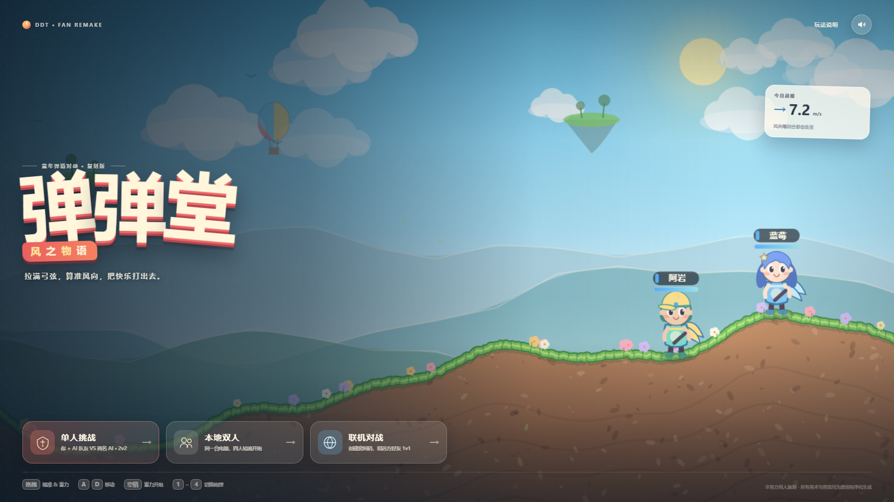
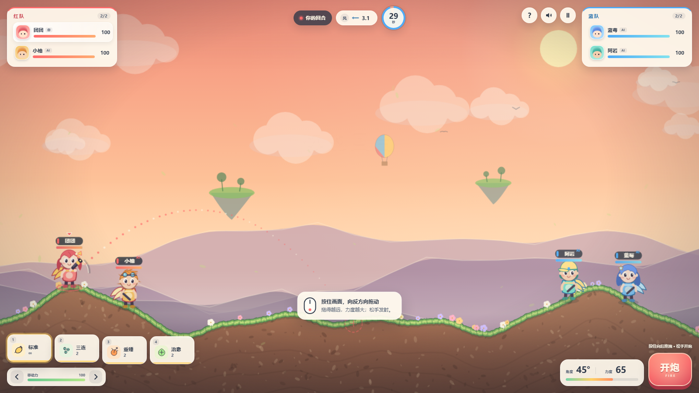
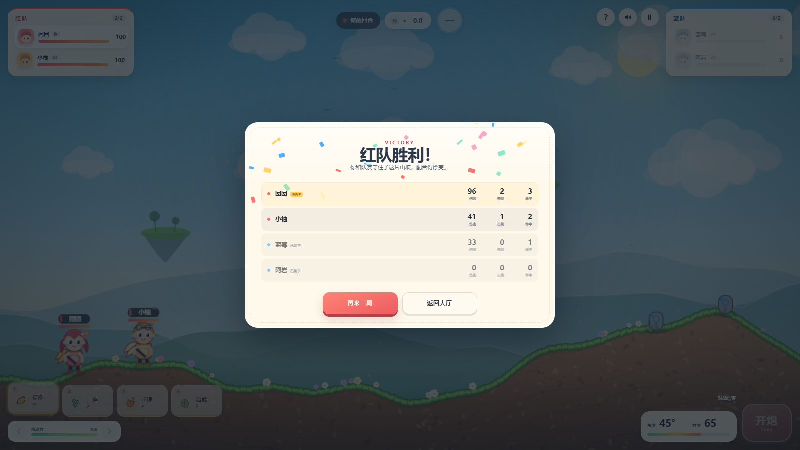
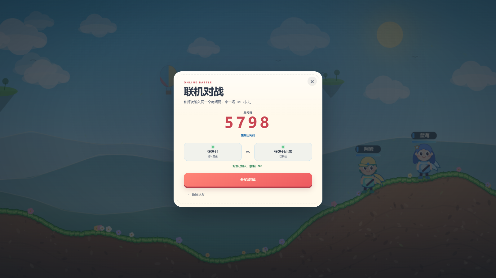
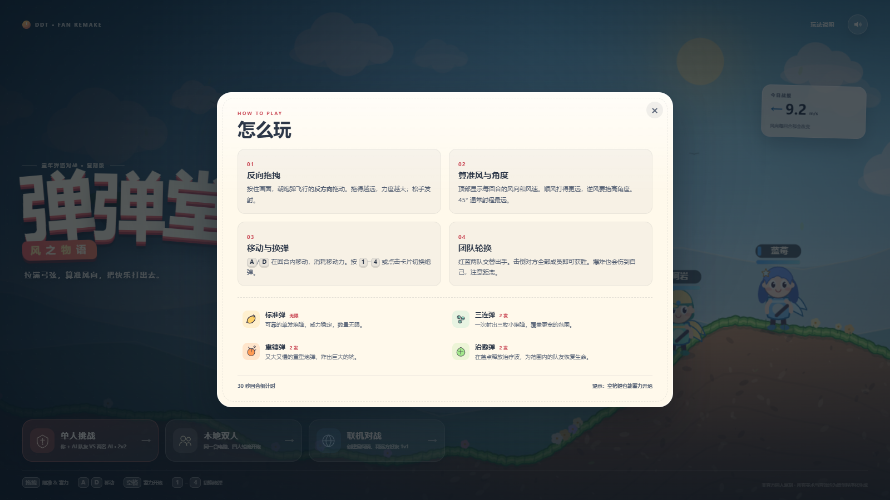

# 弹弹堂 · 风之物语

一个写给童年回忆的浏览器弹道对战小游戏。反向拖拽瞄准、算风向、抬角度、炸地形，支持 **单人挑战、本地四人轮流、联机 1v1**。

> 非官方同人复刻。所有角色、场景、音效均为本项目原创 / 程序化生成，不包含官方美术或音频素材。



## 快速开始

需要 Node.js 18+。

```bash
npm install
npm run dev
```

打开 **http://localhost:3000** 即可开玩。`npm run dev` 会同时启动 Vite 页面服务、HMR 和房间服务器。

生产运行：

```bash
npm run build
npm start
# 自定义端口：PowerShell 中 $env:PORT=8080; npm start
```

单人挑战和本地双人不需要联机；联机对战需要页面由同一台服务器提供（`npm run dev` 或 `npm start`）。

### 部署到公网 / 宝塔面板

项目自带 [DEPLOY-BAOTA.md](DEPLOY-BAOTA.md)、[ecosystem.config.cjs](ecosystem.config.cjs) 和 [deploy/nginx-ws.conf](deploy/nginx-ws.conf)，按照文档部署即可保留完整联机功能。核心是：**一个 Node 进程 + PM2 + 宝塔 Nginx 反向代理，并把 `/ws` 的 WebSocket 升级头转发到 3000 端口**。

## 三种模式

| 模式 | 内容 | 适合 |
| --- | --- | --- |
| 单人挑战 | 2v2：你 + 1 名 AI 队友 VS 2 名 AI 敌人 | 一个人打一局 |
| 本地双人 | 2v2：同一台电脑，四名玩家轮流操作 | 和朋友挤在一台电脑前 |
| 联机对战 | 1v1：创建 4 位房间码，好友输入房间码加入 | 异地开黑 |

联机时两个人必须访问同一个服务器：

- 本机测试：两个浏览器标签页都打开 `http://localhost:3000`
- 局域网：好友打开 `http://<你的局域网 IP>:3000`，防火墙放行端口
- 房间由房主创建，好友加入后房主点“开始对战”

联机采用 **房主结算 + 快照同步**：双方各自播放炮弹动画，回合结束后由房主把地形、血量、风向和下一回合状态同步给挑战者。

## 怎么玩

1. **按住画面，朝炮弹飞行的反方向拖动**，拖得越远力度越大，松手发射。
2. 顶部显示每回合的 **风向 / 风速**。顺风更远，逆风更近；45° 左右通常能打出最远射程。
3. 每回合有 **30 秒**（联机 35 秒）行动时间。可先用移动力左右移动，再开炮。
4. 爆炸会破坏地形，也会伤到自己和队友，注意距离。
5. 红蓝两队交替行动；击倒对方全部成员获胜。

### 键盘操作

| 按键 | 功能 |
| --- | --- |
| `A` / `D` 或 `←` / `→` | 左右移动（消耗移动力） |
| `W` / `S` 或 `↑` / `↓` | 调整角度 |
| 按住 `空格` 再松开 | 蓄力并发射 |
| `1` – `4` | 切换炮弹 |
| `Esc` | 暂停 / 返回 |

鼠标与触屏都支持反向拖拽；底部“开炮”按钮会使用当前角度和力度发射。

## 炮弹

- **标准弹**：无限，稳定单发
- **三连弹**：一次三发，适合覆盖和补刀
- **重锤弹**：又大又慢，炸出巨大弹坑
- **治愈弹**：在落点释放治疗波，为范围内队友回血

## 一些实现细节

- **引擎**：TypeScript + Canvas 2D，固定时间步进；地形是一张可破坏的高度图，爆炸按圆弧向下削去地面。
- **美术**：全部用 Canvas 矢量绘制，角色、云、山、花草、UI 图标都是代码生成；地面纹理由固定种子生成，因此联机双方看到同一张地图。
- **AI**：先用真实弹道模拟搜索角度和力度，再叠加“手感误差”；会移动、换弹、给残血队友治疗。
- **音效**：Web Audio 实时合成，无外部音频文件。
- **联机**：Node.js + `ws` 房间服务器，支持创建 / 加入 / 断线通知；页面与 WebSocket 同源同端口。
- **构建**：Vite 5。

```text
src/
  main.ts       入口、输入、游戏循环、模式切换
  game.ts       回合、炮弹、伤害、地形、联机快照
  terrain.ts    地图生成与弹坑
  physics.ts    共用弹道模拟
  ai.ts         AI 搜索与行动
  renderer.ts   Canvas 场景、角色、粒子、镜头
  ui.ts         菜单 / HUD / 房间 / 结算 / 帮助
  online.ts     联机客户端
  audio.ts      Web Audio 合成音效
server.mjs      静态服务 + Vite + 房间 WebSocket
```

## 截图

| 对战 | 结算 |
| --- | --- |
|  |  |

| 联机房间 | 玩法说明 |
| --- | --- |
|  |  |

## 声明

这是一个非商业的同人练习项目，用来纪念小时候玩弹弹堂的快乐。项目与第七大道 / 弹弹堂官方没有任何关联，不包含官方素材；“弹弹堂”相关商标归原权利人所有。
